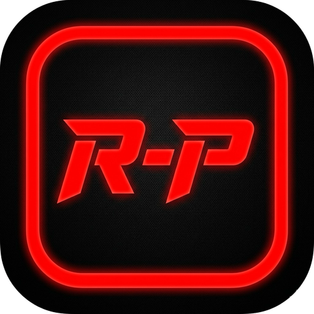

<p align="center">
  
</p>

# Rugdraiger Play

Reproductor de música local con versión **web/PWA**, **Android**, **Flutter** y
una app de escritorio optimizada para **macOS Apple Silicon**.

## macOS (MacBook Air M1–M4)

La versión recomendada para Mac usa Electron nativo `arm64`, comparte la misma
interfaz que la web y no necesita Xcode para compilarse.

**[Descargar la última versión para macOS Apple Silicon](https://github.com/RUGDRAIGER/rugdraiger_play/releases/latest/download/RugdraigerPlay-macOS.zip)**

[Verificar SHA-256](https://github.com/RUGDRAIGER/rugdraiger_play/releases/latest/download/RugdraigerPlay-macOS.zip.sha256)

```bash
cd macos
./build-macos.sh
open "RugdraigerPlay/Rugdraiger Play.app"
```

Requisitos: macOS 13 o posterior, Node.js 22 o posterior y un Mac Apple Silicon.
El script instala dependencias reproducibles, compila sólo los recursos de la
app, firma localmente el paquete, comprueba su arquitectura y genera:

- `macos/RugdraigerPlay/Rugdraiger Play.app`
- `macos/RugdraigerPlay-macOS.zip`
- `macos/RugdraigerPlay-macOS.zip.sha256`

La compilación Flutter para macOS sigue disponible con
`./build-macos.sh --flutter`, pero requiere Xcode completo. Consulta [la guía de
macOS](macos/README.md) para pruebas, publicación e instalación.

En **Ajustes → Biblioteca remota** puedes conectar una cuenta Navidrome. La
contraseña se conserva cifrada mediante el Llavero de macOS y se valida usando
la API Subsonic sobre HTTPS; no se incluye ninguna credencial en el código. La
app sincroniza el catálogo, muestra sus carátulas, reproduce el audio remoto y
separa visualmente cada pista y álbum con insignias **Local** o **Navidrome**.

## Web

```bash
cd web
npm ci
npm run dev
```

Abre `http://localhost:5199` en Chrome (puerto distinto al proyecto bomberos, que usa 5173).

### PWA + Android

La app web es una **PWA** lista para empaquetar con [PWA Builder Studio](https://marketplace.visualstudio.com/items?itemName=PWABuilder.pwa-studio).

Guía completa: [`android-twa/ANDROID.md`](android-twa/ANDROID.md)

### Publicado en GitHub Pages

https://RUGDRAIGER.github.io/rugdraiger_play/

Para actualizar la web publicada:

```bash
cd web
VITE_BASE_PATH=/rugdraiger_play/ npm run build
cd dist && git init -b gh-pages && git add -A && git commit -m "Deploy"
git push -f origin gh-pages
```

## Flutter

```bash
cd rugdraiger_player
flutter pub get
flutter run
```
